# cv-pilznet


Automatische Pilzerkennung mittels Deep Learning: Klassifikation von Pilzfotos nach Art (169 Klassen) und daraus abgeleitet nach essbar/giftig.

## Projektidee

Pilze sind in der Natur oft schwer zu unterscheiden. Essbare und giftige Arten sehen sich zum Verwechseln ähnlich. Ziel des Projekts ist ein Bildklassifikationsmodell, das Pilze anhand von Fotos automatisch erkennt und als essbar oder nicht essbar einordnet. Das hat praktischen Nutzen für Pilzsammler und könnte Grundlage für eine mobile Bestimmungs-App sein. Gleichzeitig ist die Aufgabe ein gutes Beispiel, um moderne Deep-Learning-Methoden aus der Bildverarbeitung (Transfer Learning, CNN-Architekturvergleich) in der Praxis anzuwenden.

Statt essbar/giftig direkt zu trainieren, klassifiziert das Modell 169 Pilzarten; die essbar/giftig-Einordnung wird danach über eine feste Zuordnungstabelle (`src/class_mapping.py`) aus der Art-Vorhersage abgeleitet.

## Related Work und Datensatz

Für die Bildklassifikation werden klassischerweise Convolutional Neural Networks in Kombination mit Transfer Learning eingesetzt: ein auf ImageNet vortrainiertes CNN wird auf den Zieldatensatz feinabgestimmt, statt von Grund auf zu trainieren. Für dieses Projekt werden zwei gängige Architekturen verglichen: **MobileNetV2** (klein, schnell) und **ResNet50** (größer, tendenziell genauer).

**Datensatz:** [Mushroom Species Recognition Dataset](https://www.kaggle.com/datasets/zlatan599/mushroom1) (Kaggle, zlatan599), Fotos von 169 Pilz-/Flechtenarten, aufgeteilt in Train/Val/Test.

## Vorgehen

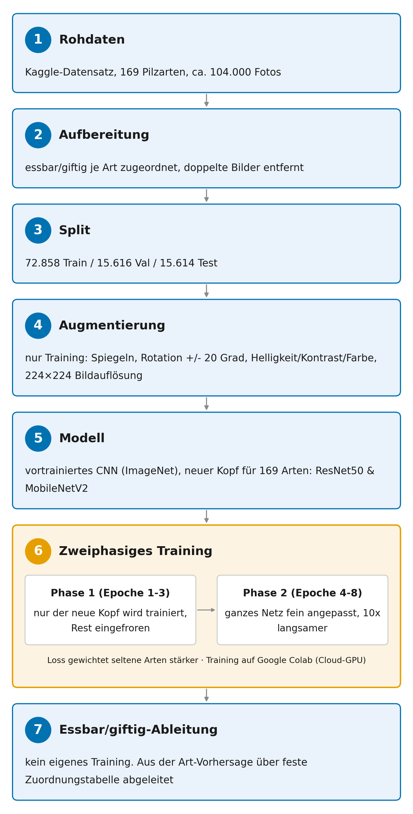

**Environment:** Conda-Umgebung `pilznet` mit allem Nötigen (PyTorch, torchvision, scikit-learn, albumentations, Kaggle-CLI):

```bash
conda env create -f environment.yml
conda activate pilznet
```

**Datensatz:** liegt nicht im Repo (`data/raw/` ist in `.gitignore`), muss man sich selbst von Kaggle holen:

1. Kaggle-Account + API-Token erstellen
2. Token speichern. Nicht mit Notepad, das speichert falsch kodiert und die CLI kann den Token dann nicht lesen:

```powershell
mkdir $env:USERPROFILE\.kaggle -Force
Set-Content -Path "$env:USERPROFILE\.kaggle\access_token" -Value "DEIN_TOKEN_HIER" -NoNewline -Encoding ascii
```

3. Login testen und Datensatz laden:

```bash
kaggle auth login
kaggle datasets download -d zlatan599/mushroom1 -p data\raw --unzip
```

Sieht danach so aus:

```
data/raw/
    merged_dataset/
        Agaricus/
            img001.jpg
            ...
        Amanita/
            ...
    test.csv
    train.csv
    val.csv
```

**Labels aufbereiten:** führt die Kaggle-Split-CSVs mit `class_mapping.py` (essbar/giftig je Art) zusammen:

```bash
python src/build_labels.py
```

Erzeugt `data/processed/{train,val,test}.csv`. Der Datensatz enthält bewusste Duplikate zum Oversampling der Minderheitsklassen, die werden hier pro Split auf eindeutige Bilder reduziert. Die Klassenbalance holen wir uns stattdessen über eine Gewichtung im Loss (`train.py`, seltene Arten zählen mehr).

**Training (Google Colab):** lokal gibt's keine NVIDIA-GPU, deshalb läuft das Training in Colab: `notebooks/train_colab.ipynb` hochladen, GPU-Laufzeit an, Zellen von oben nach unten durchklicken. Am Ende `models/*.pt` und `results/*_history.json` herunterladen und in die entsprechenden Ordner legen. Trainiert wurde z.B. mit:

```bash
python src/train.py --arch mobilenet_v2 --epochs 8 --freeze-epochs 3 --batch-size 96
```

Schneller lokaler Smoke-Test (kein echtes Training, läuft auch auf CPU):

```bash
python src/train.py --arch mobilenet_v2 --epochs 2 --freeze-epochs 1 --batch-size 4 --limit 40
```

**Auswertung:**

```bash
python src/evaluate.py --checkpoint models/mobilenet_v2.pt --split test
```

Erzeugt pro Modell die Confusion Matrix auf Art- und Binär-Ebene (`results/<arch>_<split>_confusion_*.png` + `_report_*.csv`).

**Weitere Auswertungsskripte:**

- `python src/confusion_pairs.py --checkpoint models/resnet50.pt --top 5` listet die Verwechslungspaare je Art auf, sortiert nach Anteil an der wahren Klasse.
- `python src/predictions.py --checkpoint models/resnet50.pt --images-dir data/domain_shift_test --labels-csv data/domain_shift_test/labels.csv` testet das Modell auf eigenen Fotos außerhalb des Trainingsdatensatzes (Domain-Shift) bzw. auf komplett unbekannten Arten (Out-of-Domain).
- `python src/plot_training_curves.py`, `python src/plot_results_table.py`, `python src/plot_domain_shift_table.py`, `python src/plot_ood_table.py` erzeugen die Diagramme/Tabellen im Abschnitt unten aus den jeweiligen Ergebnisdateien.
- `python src/summarize_results.py` fasst die Kennzahlen aus der Ergebnistabelle, dem Trainingsverlauf, dem Domain-Shift- und dem OOD-Test in `results/summary_metrics.csv` zusammen, die Top-5-Verwechslungspaare je Modell (nach Anteil an der wahren Klasse) in `results/summary_top_confusions.csv` sowie alle grenzüberschreitenden Verwechslungen (essbar ↔ giftig) in `results/summary_boundary_confusions.csv`.

## Ergebnisse und Auswertung

Getestet auf dem Testset (15.614 Bilder, 169 Arten):

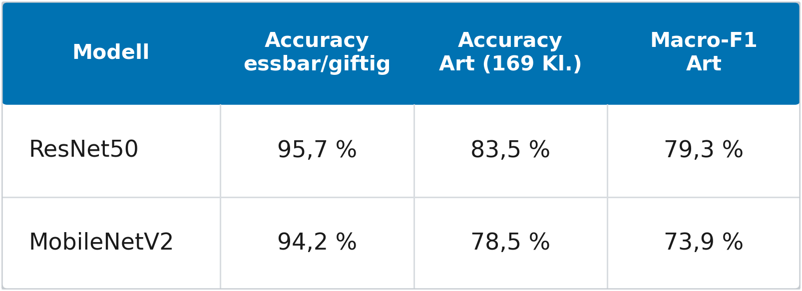

ResNet50 schlägt MobileNetV2 in beiden Aufgaben (Binär +1,5 Prozentpunkte, Artenebene +5 Prozentpunkte Accuracy).

**Trainingsverlauf** (8 Epochen):

| | ResNet50 | MobileNetV2 |
|---|---|---|
| Train-Acc (Epoche 8) | 92,5 % | 81,2 % |
| Val-Acc (Epoche 8) | 83,5 % | 79,2 % |

MobileNetV2 war nach 8 Epochen noch nicht auskonvergiert (Val-Loss sank noch), mehr Trainingszeit könnte hier noch etwas herausholen.

<table>
<tr>
<td>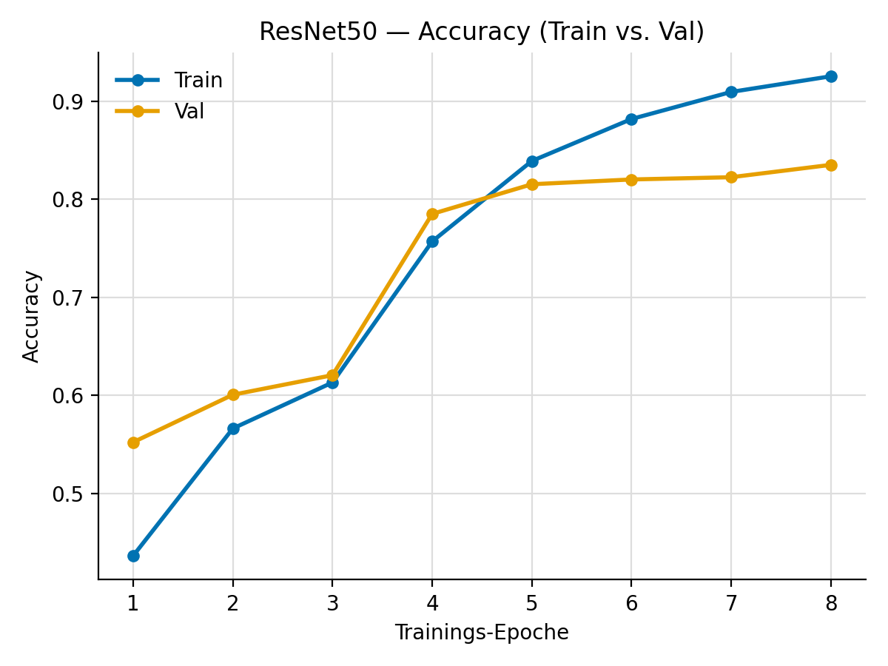</td>
<td>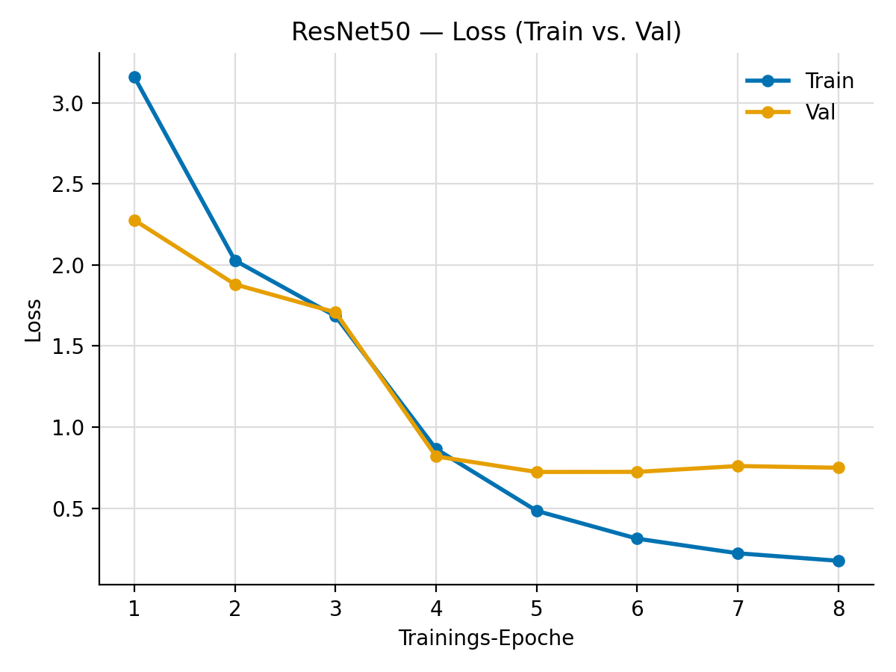</td>
</tr>
<tr>
<td>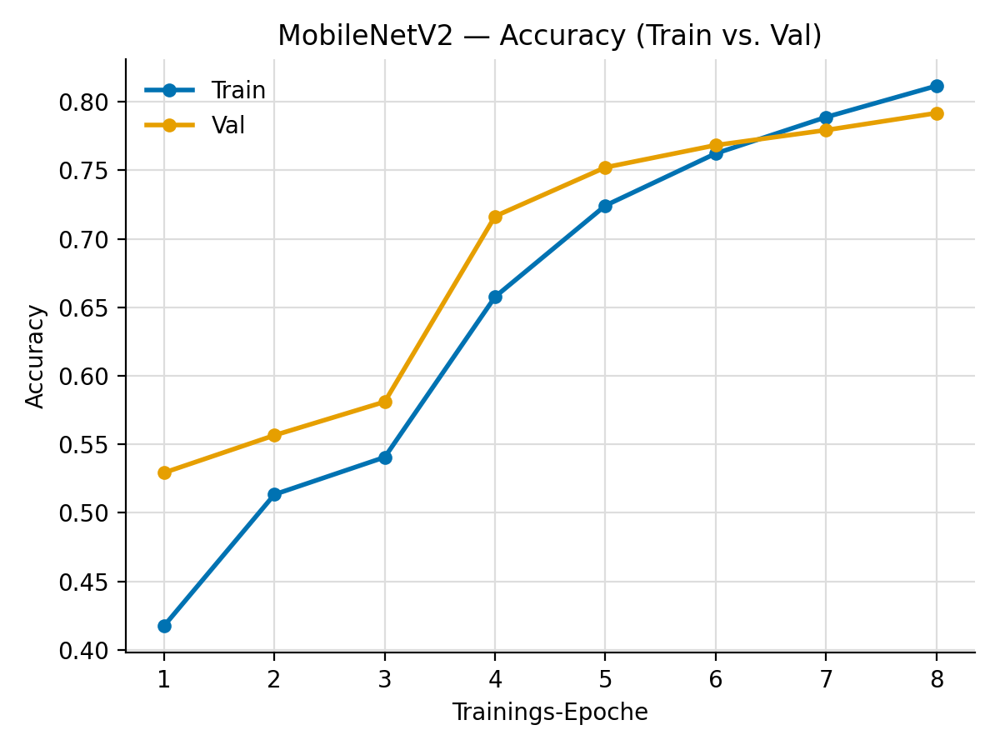</td>
<td>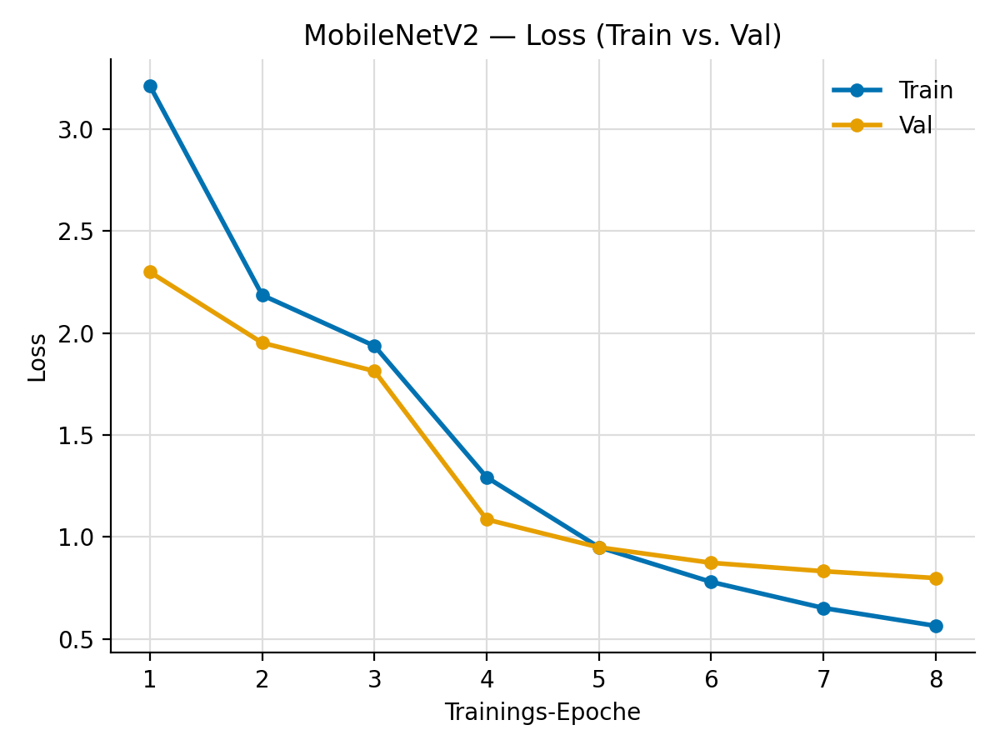</td>
</tr>
</table>

**Confusion Matrices:**

<table>
<tr>
<th></th>
<th>Art-Ebene (169 Klassen)</th>
<th>Essbar/giftig</th>
</tr>
<tr>
<td><b>ResNet50</b></td>
<td>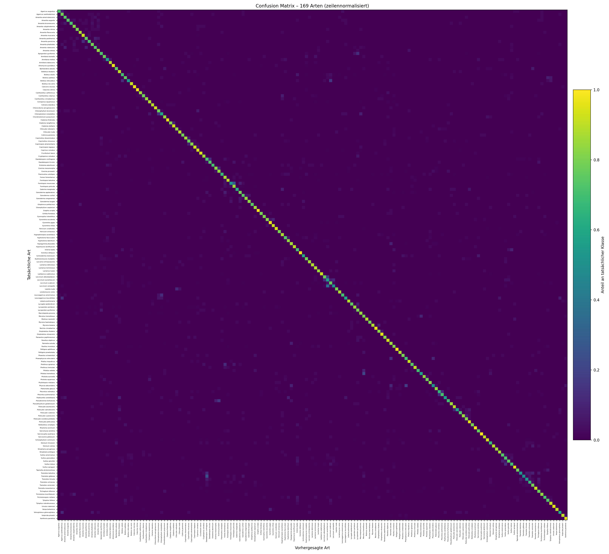</td>
<td>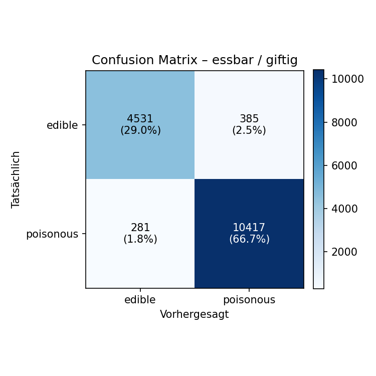</td>
</tr>
<tr>
<td><b>MobileNetV2</b></td>
<td></td>
<td>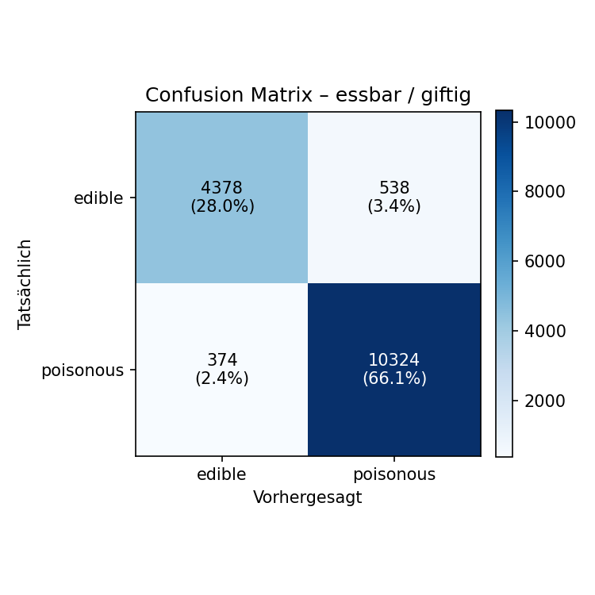</td>
</tr>
</table>

**Typische Verwechslungen** (vollständige Listen in `results/<arch>_test_confused_pairs.csv`, komplette Klassifikationsreports in `results/<arch>_test_report_{species,binary}.csv`): Top-5-Verwechslungspaare je Modell nach Anteil an der wahren Klasse, nicht nach absoluter Anzahl, sonst dominieren nur die großen Testklassen:

**ResNet50:**

| Wahre Art | Vorhergesagt als | Anteil an wahrer Klasse | Anzahl / Testbilder der Art |
|---|---|---|---|
| *Leccinum versipelle* | *Leccinum aurantiacum* | 35,9 % | 23 / 64 |
| *Fomitopsis mounceae* | *Fomitopsis pinicola* | 30,0 % | 12 / 40 |
| *Trametes gibbosa* | *Daedaleopsis confragosa* | 24,3 % | 9 / 37 |
| *Phlebia tremellosa* | *Merulius tremellosus* | 20,9 % | 9 / 43 |
| *Leccinum albostipitatum* | *Leccinum aurantiacum* | 18,6 % | 13 / 70 |

**MobileNetV2:**

| Wahre Art | Vorhergesagt als | Anteil an wahrer Klasse | Anzahl / Testbilder der Art |
|---|---|---|---|
| *Physcia adscendens* | *Phaeophyscia orbicularis* | 23,6 % | 13 / 55 |
| *Pleurotus pulmonarius* | *Pleurotus ostreatus* | 19,8 % | 19 / 96 |
| *Leccinum versipelle* | *Leccinum aurantiacum* | 18,8 % | 12 / 64 |
| *Phlebia tremellosa* | *Merulius tremellosus* | 18,6 % | 8 / 43 |
| *Fomitopsis mounceae* | *Fomitopsis pinicola* | 17,5 % | 7 / 40 |

Bei beiden Modellen tauchen *Leccinum*-Arten untereinander, *Fomitopsis mounceae*/*pinicola* und *Phlebia tremellosa*/*Merulius tremellosus* ganz oben auf. Alles nah verwandte Arten, die sich auch für Menschen kaum unterscheiden lassen.

Nach absoluter Anzahl sieht die Liste anders aus und wird von den großen Testklassen dominiert, etwa *Parmelia sulcata*/*Hypogymnia physodes* oder *Fomitopsis pinicola*/*Fomitopsis mounceae*. Fast alle häufigen Verwechslungen bleiben innerhalb derselben essbar/giftig-Gruppe. Prominenteste Ausnahme bei beiden Modellen: *Cantharellus cibarius* (essbar, Pfifferling) → *Hygrophoropsis aurantiaca* (giftig, Falscher Pfifferling) – der klassische Pfifferling-vs-Falscher-Pfifferling-Fehler, bei ResNet50 mit 7,9 % (10/126) deutlich häufiger als bei MobileNetV2 mit 1,6 % (2/126).

**Grenzüberschreitende Verwechslungen** (essbar ↔ giftig, die für die praktische Nutzung gefährlichste Fehlerklasse): vollständige Liste in `results/summary_boundary_confusions.csv` (1.152 Paare über beide Modelle, meist mit sehr kleinem Anteil), Top-5 je Modell nach Anteil an der wahren Klasse:

**ResNet50:**

| Wahre Art | Richtung | Vorhergesagt als | Anteil an wahrer Klasse | Anzahl / Testbilder der Art |
|---|---|---|---|---|
| *Leucoagaricus americanus* | essbar → giftig | *Chlorophyllum molybdites* | 12,5 % | 5 / 40 |
| *Lepista nuda* | essbar → giftig | *Clitocybe nebularis* | 11,6 % | 5 / 43 |
| *Volvopluteus gloiocephalus* | essbar → giftig | *Agaricus xanthodermus* | 11,4 % | 4 / 35 |
| *Agaricus augustus* | essbar → giftig | *Agaricus xanthodermus* | 9,8 % | 5 / 51 |
| *Coprinopsis atramentaria* | giftig → essbar | *Coprinellus micaceus* | 9,3 % | 4 / 43 |

**MobileNetV2:**

| Wahre Art | Richtung | Vorhergesagt als | Anteil an wahrer Klasse | Anzahl / Testbilder der Art |
|---|---|---|---|---|
| *Agaricus xanthodermus* | giftig → essbar | *Volvopluteus gloiocephalus* | 10,9 % | 5 / 46 |
| *Leucoagaricus leucothites* | giftig → essbar | *Volvopluteus gloiocephalus* | 10,3 % | 4 / 39 |
| *Boletus reticulatus* | essbar → giftig | *Tylopilus felleus* | 7,9 % | 3 / 38 |
| *Agaricus augustus* | essbar → giftig | *Agaricus xanthodermus* | 7,8 % | 4 / 51 |
| *Hypholoma lateritium* | essbar → giftig | *Hypholoma fasciculare* | 7,6 % | 7 / 92 |

Auffällig: *Agaricus augustus*/*xanthodermus* (Riesenegerling vs. Gelbfärbender Egerling) und *Volvopluteus gloiocephalus* als Fehlvorhersage für mehrere giftige Arten tauchen bei beiden Modellen auf.

Wiederkehrende, modellübergreifende Problemgruppen: Porlinge/Baumpilze (*Fomitopsis*-, *Fomes*-, *Ganoderma*-Arten), Flechten (*Parmelia*/*Hypogymnia*, *Evernia*-Arten, *Physcia*/*Phaeophyscia*), *Leccinum*-Arten untereinander, *Pleurotus ostreatus*/*pulmonarius* sowie *Boletus*/*Suillus*-Arten.

**Domain-Shift- und Out-of-Domain-Test** (eigene Fotos, nicht aus dem Trainingsdatensatz):

<table>
<tr>
<td align="center"><b>Domain-Shift</b> (bekannte Arten)</td>
<td align="center"><b>Out-of-Domain</b> (unbekannte Arten)</td>
</tr>
<tr>
<td>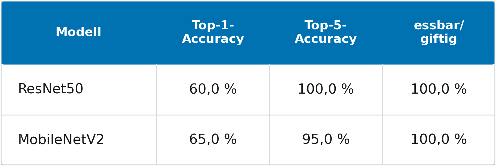</td>
<td>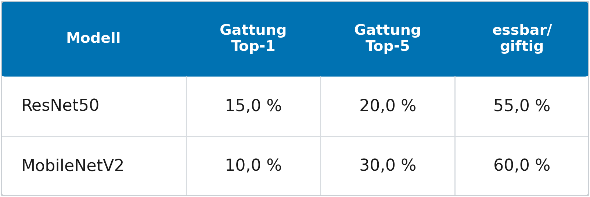</td>
</tr>
</table>

Der Domain-Shift-Test (bekannte Arten, andere Bildquelle) zeigt, dass beide Modelle auch außerhalb des Trainingsdatensatzes brauchbare Vorhersagen liefern; beim Out-of-Domain-Test (komplett unbekannte Arten) sinkt die Trefferquote erwartungsgemäß deutlich. Die Testsets hierfür sind bewusst klein (Größenordnung: einige Dutzend eigene Fotos) und dienen eher als qualitative Stichprobe denn als statistisch belastbare Auswertung. Rohdaten je Bild: `results/<arch>_domain_shift_predictions.csv`, `results/<arch>_ood_predictions.csv`.

## Poster und Slides

- Projektexposé: [Pilzerkennung.pdf](Pilzerkennung.pdf)
- Finales Poster/Slides: folgt
