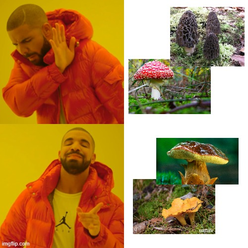

# cv-pilznet



## Setup

**Environment** — eigene Conda-Umgebung namens `pilznet`, die alles Nötige mitbringt (PyTorch, torchvision, scikit-learn, albumentations, etc.) sowie die Kaggle-CLI für den Download der Daten.

```bash
conda env create -f enviroment.yml
conda activate pilznet
```

**Datensatz herunterladen** — Daten NICHT ins Git-Repo, `data/raw/` ist deshalb in `.gitignore`.

**Einmalige Einrichtung pro Person:**

1. Kaggle-Account erstellen/anmelden
2. API-Token erstellen
3. Den angezeigten Token-String kopieren
4. In PowerShell den Ordner anlegen und den Token **ohne BOM/UTF-16** speichern (wichtig — Notepad o.ä. kann sonst eine falsche Kodierung verwenden, die die CLI nicht lesen kann):

```powershell
mkdir $env:USERPROFILE\.kaggle -Force
Set-Content -Path "$env:USERPROFILE\.kaggle\access_token" -Value "DEIN_TOKEN_HIER" -NoNewline -Encoding ascii
```

**Testen:**

```bash
kaggle auth login
```

oder gleich

```bash
kaggle datasets download -d zlatan599/mushroom1 -p data\raw --unzip
```

Danach sollte es so aussehen

```
data/raw/
    merged_dataset/
        Agaricus
            img001.jpg
            img002.jpg
            ...
        Amanita/
            ...
    test.csv
    train.csv
    val.csv
```

## Pipeline

169 Pilzarten per Transfer Learning klassifizieren (MobileNetV2/ResNet50). Die essbar/giftig-Matrix trainieren wir nicht extra, sondern leiten sie aus den Art-Vorhersagen über `class_mapping.py` ab.

**Labels aufbereiten** — führt die Kaggle-Split-CSVs mit `class_mapping.py` (essbar/giftig je Art) zusammen:

```bash
python src/build_labels.py
```

Erzeugt `data/processed/{train,val,test}.csv`. Der Datensatz hat bewusste Duplikate zum Oversampling der Minderheitsklassen drin — die reduzieren wir hier pro Split auf eindeutige Bilder (spart unnötiges mehrfaches Laden/Dekodieren beim Training). Die Klassenbalance holen wir uns stattdessen über eine Gewichtung im Loss (`train.py`, seltene Arten zählen mehr).

**Training (Google Colab)** — lokal gibt's keine NVIDIA-GPU, deshalb läuft das Training in Colab: `notebooks/train_colab.ipynb` hochladen, GPU-Laufzeit an, Zellen von oben nach unten durchklicken. Am Ende `models/*.pt` und `results/*_history.json` runterladen und in die entsprechenden Ordner legen.

Schneller lokaler Smoke-Test (kein echtes Training, läuft auch auf CPU):

```bash
python src/train.py --arch mobilenet_v2 --epochs 2 --freeze-epochs 1 --batch-size 4 --limit 40
```

**Auswertung** — läuft auf CPU (reicht locker für reine Inferenz):

```bash
python src/evaluate.py --checkpoint models/mobilenet_v2.pt --split test
```

Landet in `results/`:
- `<arch>_<split>_confusion_species.png` + `_report_species.csv` — 169×169 Confusion Matrix mit Precision/Recall/F1 je Art
- `<arch>_<split>_confusion_binary.png` + `_report_binary.csv` — essbar/giftig

Für den Architekturvergleich einfach `evaluate` für beide Checkpoints laufen lassen und Accuracy/Macro-F1 vergleichen.
